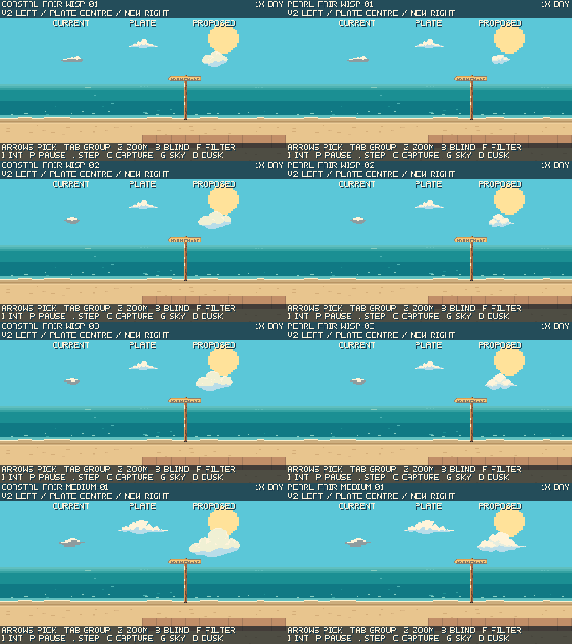
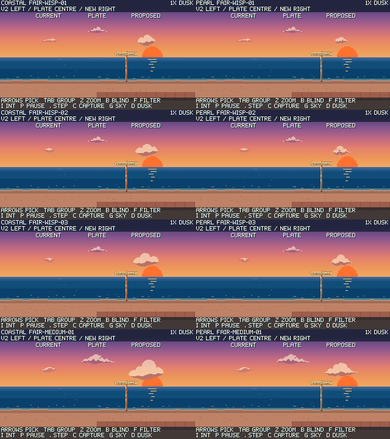

# Task 094 — lighter cloud alternatives

Two new image-generated options, kept alongside the entire first version.
Neither is selected for gameplay. `clouds-v2.png`, its JSON, source art and
first preview remain unchanged.

## Assessment of David's comments

All three comments identify real differences from the existing sky plate:

- The plate's main underside is **#b8dde9**, with a little **#90d0e1**. The
  first atlas uses the darker, less blue **#8e9b9e**. That palette restriction
  made the new clouds look heavier. These alternatives use the plate's blue
  shades instead of the shared prop palette; the global palette file is unchanged.
- First-version display heights for the three wisps and first medium cloud
  are **6, 7.5, 7.5, 9 px** at 0.5 scale. The visibility concern is justified.
- Reducing the art to two colours also discarded the transition between cream
  and shade. The alternatives retain a light mid-tone and use newly generated
  rounded contours. Sharp nearest-neighbour pixels and binary alpha remain.

## Alternatives

**Coastal:** `assets/sprites/background-v2/clouds-v2-alt-coastal.png` + `.json`.
Uses the plate's cream **#fff4da**, pale cream **#f0f0d4**, blue-grey
**#b8dde9**, and sparse windy-set blue **#90d0e1**. Fuller, taller cumulus.
This is the bigger option: some widths exceed task 094's initial approximate
size ranges, especially the 124 px large cloud. It takes appreciably more sky
space. Kept as a separate art direction for comparison.

**Pearl (recommended):** `assets/sprites/background-v2/clouds-v2-alt-pearl.png`
+ `.json`. Uses cream **#fff4da**, pearl **#e5eddf**, blue-grey **#b8dde9**,
and restrained **#90d0e1** windy accents. The extra pearl tone is an explicit
candidate palette extension for this feedback, not a global palette change.
More compact, with a more deliberate transition between top and underside.
The first two wind clouds in the Pearl generation were too round; those two
entries use the separately generated Coastal streak silhouettes with Pearl's
palette. Provenance and exact crops are recorded per entry.

Both sheets contain 12 clouds (8 fair, 4 windy), preserve generated source
detail without shrinking, and recommend 0.5 display scale. Their metadata
retains the same IDs and region contract as the first sheet. Grid: 4x3 cells,
288x144 px, minimum 8 px padding, 1152x432 atlas. Palette differences are
declared in each JSON. Original sources are complete and unmodified.

| Cloud | First version at game size | Coastal at game size | Pearl at game size |
|---|---|---|---|
| fair-wisp-01 | 25 x 6 | 29 x 18 | 21.5 x 10 |
| fair-wisp-02 | 16.5 x 7.5 | 37.5 x 20 | 29 x 15 |
| fair-wisp-03 | 17.5 x 7.5 | 42 x 22 | 35.5 x 18.5 |
| fair-medium-01 | 29 x 9 | 58 x 33.5 | 55 x 22 |

Sizes are measured rather than promised target dimensions. Even Pearl's second
and third wisps and first medium are wider than the initial approximate range.
They now remain readable, but selection should consider the additional sky
area. No source has been downsampled to conceal that difference.

## Actual Art Lab, native 1x

`lab_review.gd` instantiates **the real `scenes/art_lab.tscn`** and registers
comparisons in memory. It does not edit `data/art_lab.json`, `sprites.json`,
game scripts or project settings. Camera zoom is 1, nearest filtering is used,
and every captured image is asserted to be exactly **320x180**, without later
resizing. Sprites use their 0.5 game scale, not their raw source size.

Each capture has first-version cloud on the left, an actual cloud crop from the
existing plate in the centre, and the candidate on the right. A flat version
of the real sky is used behind them to avoid overlapping baked clouds. The
real beach, sun and sea remain visible. Dusk uses the actual unchanged shader
with local cloud textures and position/height parameters.

**48 captures**: all 12 clouds, both alternatives, day and dusk, in `lab/`.
The two contact sheets below paste the first four captures at native size;
Coastal is the left column, Pearl the right. No image scaling is applied.

Result: all four Pearl shapes remain visible at 1x. Their cream lobes and blue
lower clusters read as clouds, with less weight than the first atlas. Coastal
also reads clearly, but its bigger bodies crowd the sky more. Prefer Pearl
for further layout work; no candidate has replaced the first version.

## Reproduce / validation

1. `python assets/reference/clouds-v2-alternatives/prepare.py` (Pillow).
2. Run the Godot editor import with project-local APPDATA/LOCALAPPDATA, then:
   `Godot --path . --audio-driver Dummy --rendering-method gl_compatibility --script assets/reference/clouds-v2-alternatives/lab_review.gd`.

- Asset checks passed for 24 sprites: unique silhouettes within each sheet,
  expected IDs and set counts, exact candidate palettes, padded regular grid,
  binary alpha; original v2 PNG/JSON byte-preserved.
- Final Godot 4.7.2 import: exit 0, no errors, lossless imports, no mipmaps or
  size limits. Local log: `../task-094-alternatives-import-final.log`.
- Real lab: exit 0, all 48 native-size captures passed, no script errors.
  Standalone image-read warnings are expected; this reference fixture is not
  exported. Local log: `test-output/cloud-alternatives-lab.log`.
- First-four daylight/dusk boards and representative large/windy captures
  visually inspected. Both candidates retain readable silhouettes under dusk.
- Full gameplay integration was not rerun for these separate, unused art
  candidates. The prior task-094 baseline and final were both 17,883 checks
  with 6 existing failures; see the first version's `VALIDATION.md`.

Generation used the built-in image generator. Exact prompts are in `PROMPTS.md`.
The follow-up refinement that introduced a glow was rejected and is not used
by either candidate. All technical preparation is crop/alpha/palette/packing;
there are no code-drawn clouds and no procedural silhouette replacements.
