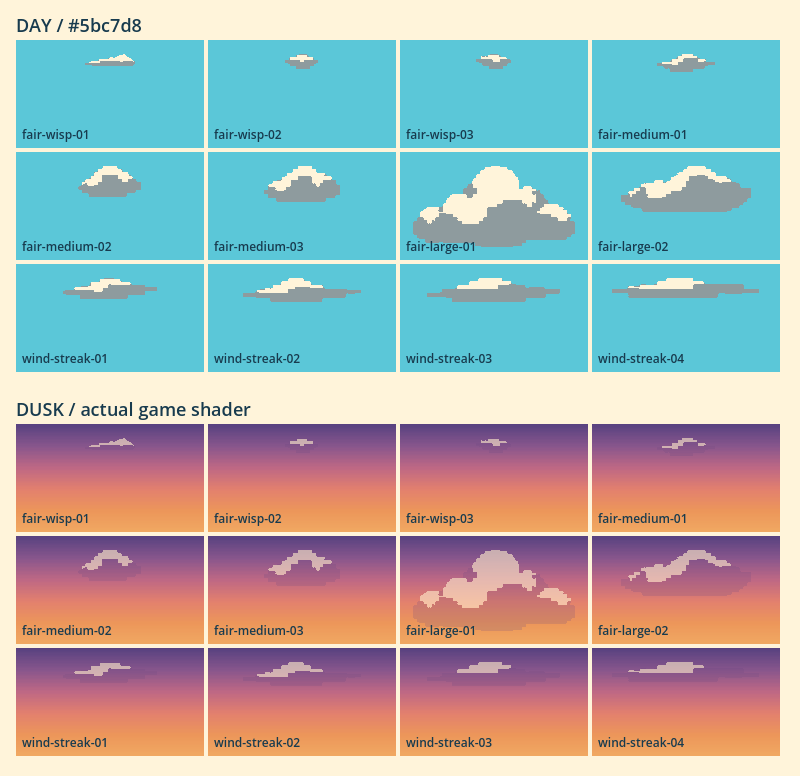
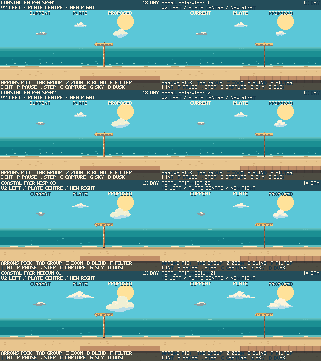

# 094 — Cloud sprite sheet (separate, transparent clouds)

Status: merged (Pearl alternative approved; use clouds-v2-alt-pearl)
Author: Claude
Assignee: Codex
Depends on: none
Created: 2026-11-16

## What David should see if this works
A sheet of individual cloud sprites on a transparent background, in a few sizes and moods, that match the current sky art. Task 095 then places them per level and drifts them with the wind. Nothing changes in game from this task alone.

## Context
- Today the sky is one baked plate: `assets/sprites/background-v2/sky-clouds-320x80.png` (5 clouds on flat sky, source in `assets/reference/background-v2/sky-clouds-source.png`). Clouds cannot be moved or varied because they are part of the image.
- Match that plate's cloud style: outline, cream highlight, soft blue-grey underside, palette from `tools/art_audit/palette.hex`. See `assets/reference/sky-clouds-v1/PROMPT.md` for the earlier prompt.
- No code-drawn art: use the image generator, then crop and align. Follow the "Art: resize, don't shrink" rule: keep full detail, smaller on screen comes from draw scale in game (task 095 draws at integer or 0.5 scales).

## Requirements
1. New sheet `assets/sprites/background-v2/clouds-v2.png`, transparent background, sharp edges, no sky colour or halo around clouds. Pack on a regular grid with a gap between cells; add `clouds-v2.json` listing each cloud's id, region `[x,y,w,h]`.
2. Set A, **fair weather** (8 clouds): 3 small wisps (about 16-24 px wide), 3 medium (about 32-48 px), 2 large (about 64-90 px). Varied silhouettes, no two alike, none a copy of the five in the current plate.
3. Set B, **overcast / windy** (4 clouds): flatter, longer, slightly greyer streaks (about 48-96 px wide) for the windier levels.
4. Clouds must read on the sky colour `#5bc7d8` and survive the dusk tint (`assets/shaders/dusk_tint.gdshader`). Check one preview of each.
5. No sky background image is needed; the game fills the sky with `SKY_COLOR`.

## Out of scope
- Any code, data or gameplay change. Do not touch the existing plate (still used by the loading screen until 095 lands).
- Sun, sea, birds.

## Done when (acceptance)
- [x] `clouds-v2.png` + `clouds-v2.json` with all 12 clouds, transparent, palette-clean
- [x] Preview image in the Report: all clouds on `#5bc7d8`, and a dusk-tinted copy
- [ ] `./tools/validate.ps1` passes with no new failures — no new failures, but the suite remains red on the same 6 baseline failures (details below).
- [x] Status `done (awaiting David)`

## Report

Implemented on `codex/094-cloud-sprite-sheet`. Asset commit: `e06831a`.

### Deliverables

- `assets/sprites/background-v2/clouds-v2.png`: 768x336 transparent atlas; 4 columns by 3 rows, 192x112 cells, at least 8 px padding.
- `assets/sprites/background-v2/clouds-v2.json`: 12 stable IDs with tight `[x,y,w,h]` regions, weather sets, size classes, recommended scales and source provenance.
- `assets/sprites/background-v2/clouds-v2.png.import`: lossless texture, mipmaps disabled, no size limit.
- `assets/reference/clouds-v2/`: complete unmodified generated source images, exact generation prompts, reproducible technical preparation, standalone Godot preview fixture, and rendered preview.

Built-in image generator used. No cloud silhouettes were drawn with code; preparation only crops, cleans alpha/palette, removes detached generation specks and packs. No source sprite was shrunk. Runtime, level data, shaders, sun, sea, birds and the existing sky plate are unchanged. The preparation and preview scripts are artwork tools under the existing reference `.gdignore`, excluded from game imports.

### Decisions and task 095 handoff

The old `sky-clouds-v1/PROMPT.md` reference does not exist. Used the existing plate and `background-v2/PROMPTS.md` for style instead.

Widths are interpreted as approximate on-screen widths. All sprites recommend 0.5 scale so source detail is preserved. Small widths: 25, 16.5, 17.5 px; medium: 29, 31.5, 38 px; large: 81, 65 px; windy: 47, 59, 66.5, 73.5 px. These are documented approximate ranges rather than downsampled files.

Two exact palette colours: cream `#fff4da` and blue-grey `#8e9b9e`. The generation's darker `#617782` accent was mapped to light blue-grey because the unchanged dusk shader would classify it as sky and erase its silhouette. The resulting windy clouds are flatter and greyer than the fair-weather clouds.

Task 095 should use `clouds[].id` lookup and tight atlas regions, nearest-neighbour filtering, no mipmaps, and snapped positions. The existing shader assumes sky-plate UVs: per-cloud tint materials need correct position/height parameters and local UVs. The standalone preview demonstrates this with separate cropped textures and the actual unchanged shader.

### Preview

All 12 sprites shown at recommended scale, enlarged 2x for inspection. Top: `#5bc7d8`; bottom: actual Godot dusk shader.

### Verification

Asset checks pass: 12 distinct sprites and unique IDs; 8 fair / 4 windy; every opaque pixel belongs to a declared region; transparent gutters; binary alpha only; exact approved palette; all recommended scales are 0.5. Godot rendered the preview successfully (`CLOUD PREVIEW: OK`); both boards were visually inspected.

Full validation ran with Godot 4.7.2 via `tools/validate.ps1 -Godot 'C:/Users/david/Desktop/Engines and set-up/Godot_v4.7.2-stable_win64_console.exe'`.

- Baseline: **17,883 checks, 6 failures**.
- Final with fresh generated mouse-input fixture: **17,883 checks, 6 failures**.
- **No new failures**. Failure messages match after normalizing generated Button instance numbers. The unchanged failures concern completed training-card wording, steering lesson wording, two level-card text checks, and two menu-button bounds checks. The existing `food_checks` out-of-bounds script error occurs once in both runs; existing resource/tree warnings also remain.
- The suite therefore does **not** exit successfully; its strict green acceptance box is deliberately left unchecked. Existing failures were not changed as part of this art-only task.
- An intermediate repeat used a persisted `test-output/mouse-role-save.json` and produced two additional mouse-input failures. That generated fixture was preserved outside the worktree and removed from the next run's inputs; the clean final run returned to the six baseline failures.
- Committed summary: `assets/reference/clouds-v2/VALIDATION.md`. Local full logs: `../task-094-baseline.log`, `../task-094-final-clean-validation.log`.

All source images were byte-compared with the image generator outputs and remain unchanged. Atlas SHA-256: `9e69fd0124077607d84c2bf72c83ba4f7ade28acb9f53543e003130b88f4d95c`.

Publishing: pushed to `origin/codex/094-cloud-sprite-sheet` with explicit David approval.

## Alternative versions after David's feedback — 2026-11-16

Assessed all three comments as justified. The existing plate's underside is
`#b8dde9`, compared with the first atlas's darker `#8e9b9e`; its two-colour
cleanup also removed a mid-tone. The three wisps and first medium displayed
at only 6, 7.5, 7.5 and 9 px high.

Reprompted the built-in image generator with the actual sky plate as a style
reference. Added two separate 12-cloud sheets and JSONs without replacing any
first-version assets:

- `assets/sprites/background-v2/clouds-v2-alt-coastal.png` + `.json`: lighter
  plate-derived blue undersides, pale cream transition, fuller rounded shapes.
  This is the larger option; some widths exceed the original approximate range.
- `assets/sprites/background-v2/clouds-v2-alt-pearl.png` + `.json`: light blue
  undersides and an extra pearl mid-tone, with more compact shapes. Recommended
  for further layout work. First-four heights are 10, 15, 18.5 and 22 px at game
  scale. Some small/medium widths are still above the initial approximate ranges.

Both retain unscaled generated detail and use 0.5 game scale. Full sources,
exact prompts, reproducible preparation and measured sizes are under
`assets/reference/clouds-v2-alternatives/`; its README explains the tradeoffs.
Pearl uses the generated Coastal shapes for two wind streaks that came out
too round in its own generation. Per-entry source provenance is retained.
An attempted refinement with unwanted glow was rejected, not used.

Checked **both alternatives in the actual Art Lab at camera zoom 1**, with
the first version on the left, a plate cloud in the centre, and candidate on
the right. Saved 48 native **320x180** captures covering all 12 clouds in day
and actual dusk shader, plus unscaled contact sheets of the first four.

[Dusk comparison](../../assets/reference/clouds-v2-alternatives/small-clouds-dusk-1x.png)

Validation: candidate asset checks pass for all 24 sprites (exact palettes,
binary alpha, distinct silhouettes within each sheet, regular grid/gutters).
Final Godot import exits 0 without errors. All 48 lab captures pass and are
320x180, with no script errors. First-four day/dusk boards and representative
large/windy captures were visually inspected. The first PNG/JSON and entire
original reference folder have no Git diff. No runtime or level data changed.
Full gameplay integration was not rerun for these unused art alternatives;
the previously reported six baseline failures remain documented above.

Publication: David explicitly approved pushing the alternatives and captures.
They are published on `origin/codex/094-cloud-sprite-sheet` alongside the first
version, which remains unchanged.

## Review notes
